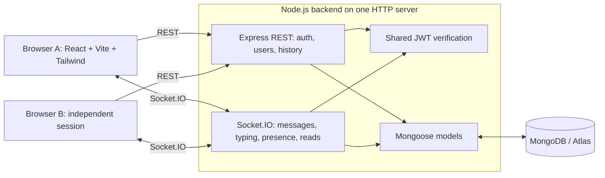

# MERN Chat

A hardened, privacy-focused, one-to-one messaging app built with React and Express. Users find and add friends, exchange live messages, and reopen saved conversations after a refresh. Buddy AI is a built-in automated companion using local keyword rules. MongoDB stores the data; Socket.IO delivers live updates. The server can read messages; this app is not end-to-end encrypted. See [SECURITY.md](SECURITY.md) for the threat model.

The repository includes deployment configuration and a recording kit. Hosted deployment and production verification have **not** been established by the local checks described here.

## Features

### Core

- Register/login with cost-12 bcrypt passwords and a versioned 24-hour JWT; restore sessions after refresh. Changing a password or logging out all devices revokes existing tokens and disconnects sockets.
- Search by at least two characters of a name/email; non-friend emails are masked. Send, accept, decline, or cancel friend requests before starting a human chat.
- Unfriend without deleting saved history; re-friending restores the same conversation. Old history remains membership-readable, but every human send/typing event requires a current friendship.
- Buddy AI is pinned first and always appears online. Its local rules include greetings, time/date, eight rotating jokes, and 242 built-in learning entries covering DSA, JavaScript, React, web development, backend, and CS basics. Try topics, dsa, more, random, or quiz me. Code examples have Copy buttons; Buddy-only quick replies use the usual message send path. No external AI API is used.
- Reuse the same conversation for a participant pair instead of creating duplicates.
- Send live text messages up to 2,000 characters, with pending/failed states, acknowledgement, and retry identity to avoid saving a retry twice.
- Persist messages/previews in MongoDB; load missed messages after reconnect and reconcile rows without duplicates.
- Show friend-scoped online/offline status across multiple tabs and temporary typing indicators. Strangers do not receive presence updates.
- Use a responsive list/chat layout, keyboard focus styles, skeletons, empty/error states, Today/Yesterday separators, and grouped bubbles.

### Implemented optional features

- **Persistent unread counts:** computed on the server from per-participant read positions.
- **Message ticks:** one check after send acknowledgement, two after the other user's socket acknowledges delivery, violet two after read. Read timestamps honor `settings.readReceipts` (default true); unread counts still work privately.
- **Message tools:** validated replies with quote jumps/swipe, six reactions, 15-minute text edits, per-user hiding, and sender-only deletion for everyone within 48 hours. Older history loads at the top; literal, membership-protected search scans the latest 500 visible messages and returns at most 30 matches.
- **Chat management and profiles:** three explicit pins, per-user mute/archive, an Archived row, blocking/unblocking, name/About edits, private original avatars with 512px thumbnails, and persisted last seen.
- **Disappearing messages:** Off/1 hour/24 hours/7 days for new messages, system notices, and media-first expiry cleanup. Browser notifications require a click to enable, appear only while the open tab is hidden, respect mute, and hide previews by default.
- **Theme system:** light/dark toggle on auth pages and in the sidebar; first visit follows the system preference. Semantic CSS tokens, pre-React initialization, and localStorage persistence use Tailwind v4's class-based theme support. See the [theme audit and screenshots](docs/THEME_AUDIT.md).
- **Photos:** up to ten JPEG/PNG/WebP/GIF files per message, 25 MiB each. The default-on profile toggle removes JPEG APP1 Exif bytes without re-encoding pixels; other bytes remain intact. Invalid parsing preserves the original with a warning. Separate thumbnails, captions, progress/cancel/retry, paste/drop, a zoomable viewer, and original downloads use private storage and signed URLs. Buddy refuses photos.
- **Security:** Helmet, bounded bodies/socket packets, per-process rate limits, a deployment-specific CSP, and AES-256-GCM encryption of message text/captions and profile About text at rest. This protects encrypted fields in a database dump without its key, not against a compromised server. Media bytes use private storage rather than this field-encryption layer.
- **Camera and emoji:** explicit camera capture with cleanup and native-camera fallback; a lazy-loaded themed emoji picker and larger one-to-three-emoji bubbles. Camera automation uses simulated hardware; real devices and production R2 still require manual checks.

There are no groups, calls, status posts, voice notes, end-to-end encryption, or service-worker push notifications. Uploads are limited to supported image formats; HEIC, SVG, HTML, and other attachments are refused. History initially loads 50 messages and pages older messages as you scroll upward. Presence is held in one backend process's memory; multi-instance coordination is not implemented. The optional full reaction picker is omitted; six reactions are available.

## Tech stack

| Layer | Tools |
| --- | --- |
| Frontend | React 19, Vite 8, React Router, Tailwind CSS v4 |
| UI/networking | Lucide, React Hot Toast, Axios, Socket.IO client |
| Backend | Node.js ESM, Express 4, Socket.IO 4 |
| Data/auth | MongoDB, Mongoose 9, bcryptjs, jsonwebtoken |
| Verification | Node test runner, API/socket integration script, Playwright Chromium |
| Hosting configuration | Render backend, Vercel frontend, MongoDB Atlas |

## Architecture



REST uses `Authorization: Bearer <token>`; Socket.IO verifies the JWT in `handshake.auth.token`. Sockets join `user:<id>` rooms. The message handler checks membership, validates content, saves the message, and updates the conversation. It then queues `message:new` to participant rooms except the sending socket and returns the sender's acknowledgement. Persistence precedes both delivery paths.

Read positions are server timestamps stored in `Conversation.lastReadAt`, keyed by participant ID. Read updates do not change conversation ordering. `Friendship` stores one pending/accepted record per unique participant pair; decline, cancel and unfriend delete that record. Buddy is initialized after database connection; existing users get its conversation on their next conversation listing. See the [architecture walkthrough](docs/ARCHITECTURE.md).

## Prerequisites

- **Node 20.19+ or Node 22.12+** (the supported 22+ minimum for the installed Vite version). Node 24 is recommended and selected in the Render configuration.
- npm, included with Node, and Git.
- A running MongoDB instance or Atlas database with valid user/network access.
- Two independent browser sessions for a two-user demo; Chromium for E2E tests.

`server/package.json` declares `node >=20`; locked Mongoose/Vite dependencies require the more precise minimum above. There is no root npm package: `server` and `client` are separate npm projects.

## Installation

```sh
git clone https://github.com/AryanRaj7SST/chit-chat.git
cd chit-chat
```

### Windows PowerShell

Run from the repository root. These copies preserve an existing private `.env` file.

```powershell
cd server
npm ci
if (-not (Test-Path .env)) { Copy-Item .env.example .env }
cd ../client
npm ci
if (-not (Test-Path .env)) { Copy-Item .env.example .env }
cd ..
```

### macOS/Linux or another POSIX shell

```sh
cd server
npm ci
[ -f .env ] || cp .env.example .env
cd ../client
npm ci
[ -f .env ] || cp .env.example .env
cd ..
```

Edit the ignored `.env` files with your own settings. Do not put database credentials or signing secrets in the client, Git, recordings, or command output.

## Environment variables

All values below are **examples/placeholders**, not working credentials.

### Server: server/.env

| Name | Example value | Purpose |
| --- | --- | --- |
| `PORT` | `5000` | Local HTTP/Socket.IO port; Render supplies this automatically |
| `NODE_ENV` | `development` | Use `production` on Render; production blocks demo seeding |
| `MONGO_URI` | `mongodb+srv://<user>:<encoded-password>@<cluster>/mern-chat?retryWrites=true&w=majority` | Private database URI |
| `JWT_SECRET` | `<your-long-random-private-secret>` | Shared signing/verification secret for REST and Socket.IO |
| `MESSAGE_ENC_KEY` | `<base64-encoded-32-random-bytes>` | Backend-only field encryption key; required in production; keep a recovery backup |
| `CLIENT_URL` | `http://localhost:5173` | Allowed frontend origins; accepts a comma-separated list |
| `NODE_VERSION` | `24` | Render runtime setting, already specified in render.yaml |
| `STORAGE_DRIVER` | `local` | Development default; production must use `r2` |
| `PUBLIC_API_URL` | `http://localhost:5000` | Origin for local signed media links, matching the backend port |
| `R2_ACCOUNT_ID` | `<account-id>` | R2 endpoint account when using `r2` |
| `R2_ACCESS_KEY_ID` | `<private-access-key-id>` | Bucket-scoped R2 credential; server only |
| `R2_SECRET_ACCESS_KEY` | `<private-secret-access-key>` | Bucket-scoped R2 credential; server only |
| `R2_BUCKET` | `<private-bucket-name>` | Private bucket with public access disabled |
| `MESSAGE_EDIT_WINDOW_MS` | `900000` | Optional development test override; production always enforces 15 minutes |

`MONGO_URI` and `JWT_SECRET` are required at startup. Production also requires `MESSAGE_ENC_KEY`; development without it warns and writes plaintext. From `server`, `npm run key:create` creates the key in ignored `.env` without printing it and refuses to replace an existing key. Back it up privately. For existing data, follow the backup/migration steps in [DEPLOYMENT.md](docs/DEPLOYMENT.md#security-hardening-rollout-phase-58) before enabling real traffic. For multiple clients, `CLIENT_URL` can be `http://localhost:5173,https://your-client.vercel.app`. Whitespace and trailing slashes are removed; use exact origins without paths. HTTP and Socket.IO polling share this CORS list. JWT and membership checks apply independently of CORS.

For local development, `server/.uploads` stores images and stays ignored by Git.
If you change `PORT`, update `PUBLIC_API_URL` too. Never use this ephemeral local
driver on Render; production startup rejects it. Configure the private R2 bucket
and its separate browser CORS policy using [DEPLOYMENT.md](docs/DEPLOYMENT.md).

### Client: client/.env

| Name | Example value | Purpose |
| --- | --- | --- |
| `VITE_API_URL` | `http://localhost:5000/api` | Absolute backend API URL; must end in `/api` |
| `VITE_SOCKET_URL` | `http://localhost:5000` | Backend origin; no `/api` or `/socket.io` suffix |
| `CSP_R2_ORIGIN` | `https://<account-id>.r2.cloudflarestorage.com` | Public storage origin used only by `configure:csp`; never storage credentials |

Both client variables are required public build-time values. Missing/malformed URLs fail validation instead of using the frontend host. Restart Vite after editing `.env`; rebuild/redeploy for a production change. Never put secrets in `VITE_*` variables.

Before Vercel deployment, run `npm run configure:csp` in `client` using your actual public API/socket/storage URLs. Review and commit `vercel.json`: its committed `example.invalid` origins are placeholders and Vercel does not substitute environment variables inside static JSON headers. See the deployment guide.

### Verification-script settings

| Name | Example value | Purpose |
| --- | --- | --- |
| `BASE_URL` | `http://localhost:5000` | API/socket integration target; no `/api` suffix |
| `E2E_BASE_URL` | `http://localhost:5173` | Browser test's frontend target |

These are command settings, not additional client application variables.

## MongoDB Atlas setup

1. Sign in to Atlas, select/create a project, and create or select a cluster.
2. Open **Security → Database Access → Add New Database User**. Create a password-authenticated database user with `readWrite` access to `mern-chat`. This user is distinct from your Atlas login.
3. Under **Security → Network Access → Add IP Address**, allow the machine connecting to the database. For the documented Render demo setup, add `0.0.0.0/0` using **Allow Access from Anywhere**; authentication remains required.
4. On the cluster, choose **Connect → Drivers → Node.js**. Copy the URI privately, substitute the database credentials, percent-encode reserved credential characters, and insert `/mern-chat` before the query string.
5. Save the result only as the backend's `MONGO_URI`. Collections are created on first write. Keep Mongoose's unique indexes enabled for emails, participant pairs, and message retry identities.

The [deployment guide](docs/DEPLOYMENT.md#1-mongodb-atlas) has detailed steps and official references. For local MongoDB, a URI such as `mongodb://127.0.0.1:27017/mern-chat` can be used instead.

## Run locally

These commands work in PowerShell and general shells. Start two terminals at the repository root, then enter the indicated directory.

**Terminal 1 — backend:**

```sh
cd server
npm run dev
```

**Terminal 2 — frontend:**

```sh
cd client
npm run dev
```

Open `http://localhost:5173`. Backend health is at `http://localhost:5000/api/health`. If Vite selects another port because 5173 is busy, free that port or update `CLIENT_URL` and restart the backend.

For the backend without watch mode, use `npm start` in `server`. To preview built frontend assets, run `npm run build` then `npm run preview` in `client`. Vite preview normally uses port 4173: add `http://localhost:4173` to `CLIENT_URL` and restart the backend before testing that preview. This is a local preview, not the hosted deployment.

### Demo seed and recording

From `server`, with a separate development/demo database configured:

```sh
npm run seed:demo
```

This creates/reuses Alice Johnson and Bob Smith and prints intentionally public demo credentials. It refuses `NODE_ENV=production`, preserves existing messages, and does not overwrite accounts with different details. Do not use these accounts or bypass the guard on a production database.

Use a normal window and an incognito/private window for independent sessions. See the [narration script](docs/VIDEO_SCRIPT.md) and [recording checklist](docs/RECORDING_CHECKLIST.md).

## Project structure

```text
.
├── README.md
├── AGENTS.md
├── render.yaml                  # Render backend Blueprint
├── client/
│   ├── .env.example
│   ├── package.json / package-lock.json
│   ├── vercel.json              # SPA rewrite
│   ├── vite.config.js
│   ├── public/favicon.svg
│   ├── scripts/                 # Browser, message and URL tests
│   └── src/
│       ├── components/          # Sidebar, chat, input, bubbles, loading states
│       ├── context/             # Authentication and socket lifecycle
│       ├── hooks/
│       ├── pages/               # Login, Register, ChatPage
│       ├── services/            # Validated URLs, Axios, socket creation
│       ├── utils/
│       ├── App.jsx / main.jsx
│       └── index.css
├── server/
│   ├── .env.example
│   ├── package.json / package-lock.json
│   ├── scripts/                 # API verification, CORS tests, demo seed
│   └── src/
│       ├── config/              # MongoDB and shared CORS settings
│       ├── controllers/
│       ├── middleware/          # JWT protection, membership, errors
│       ├── models/              # User, Friendship, Conversation, Message
│       ├── bot/buddy.js          # Buddy account, welcome, local reply rules
│       ├── routes/
│       ├── socket/index.js
│       ├── utils/
│       └── app.js / server.js
└── docs/
    ├── ARCHITECTURE.md
    ├── DEPLOYMENT.md
    ├── TESTING.md
    ├── VIDEO_SCRIPT.md
    └── RECORDING_CHECKLIST.md
```

## REST API

Paths include `/api`. Protected requests require `Authorization: Bearer <token>`. Success responses contain `success: true`; errors contain `{ success: false, message }` with an appropriate HTTP status.

| Method | Endpoint | Authentication | Request / successful response |
| --- | --- | --- | --- |
| GET | `/api/health` | Public | `{ success, message: "API is running" }` |
| POST | `/api/auth/register` | Public | `{ name, email, password }`; 201 with `{ success, token, user }` |
| POST | `/api/auth/login` | Public | `{ email, password }`; `{ success, token, user }` |
| GET | `/api/auth/me` | JWT | `{ success, user }` |
| POST | `/api/auth/logout-all` | JWT | Increments tokenVersion and disconnects all account sockets; login again |
| POST | `/api/auth/change-password` | JWT | `{ currentPassword, newPassword }`; validates current password, changes hash, revokes all tokens/sockets |
| GET | `/api/users?q=<search>` | JWT | Query needs 2+ characters; up to 20 non-bot results with _id, name, maskedEmail, relationship and optional pending requestId; full email only for friends |
| POST | `/api/friends/requests` | JWT | `{ userId }`; 201 pending `{ success, status, requestId }`, or 200 auto-accepted `{ success, status, user }` for a mutual request; duplicates 409, 20 attempts/user/hour |
| GET | `/api/friends/requests` | JWT | `{ success, incoming, outgoing }`; items `{ _id, user: { _id, name }, createdAt }` |
| POST | `/api/friends/requests/:id/accept` | JWT + recipient | `{ success, status: "accepted", user }` |
| POST | `/api/friends/requests/:id/decline` | JWT + recipient | Delete pending request; `{ success }` |
| DELETE | `/api/friends/requests/:id` | JWT + requester | Cancel pending request; `{ success }` |
| GET | `/api/friends` | JWT | `{ success, friends }`; accepted friends with _id, name, email |
| DELETE | `/api/friends/:userId` | JWT | Unfriend and retain history; `{ success }`; Buddy cannot be unfriended |
| GET | `/api/conversations` | JWT | Own friend/Buddy conversations, including empty ones, with participants (including isBot), lastMessage, lastReadAt, unreadCount |
| POST | `/api/conversations` | JWT | `{ userId }`; get/create accepted-friend or Buddy pair; non-friend 403 "You can only message friends" |
| GET | `/api/conversations/:id/messages?limit=50&before=<ISO-date>` | JWT + membership | `{ success, messages, hasMore, lastReadAt }`; default 50, limit 1–100; before also accepts `ISO-date\|messageId` for timestamp ties; `q` performs literal search capped at 30; `around=<messageId>` includes that target and older context |
| PATCH | `/api/conversations/:id/settings` | JWT + membership + friendship | Boolean `pinned`, `muted`, `archived`; persistent per-user settings, three explicit pins maximum |
| PATCH | `/api/users/me` | JWT | Own `name`, `about` (140 graphemes), `avatar: { key, thumbKey }`; returns own public profile |
| GET | `/api/users/blocked` | JWT | Own blocked-user names/IDs only |
| POST | `/api/users/:id/block` | JWT | Block either direction for messaging/discovery, remove friendship/pending requests; no self/Buddy block |
| DELETE | `/api/users/:id/block` | JWT | Remove only the caller's block; does not restore friendship |

Registration requires a 2–50 character name, valid email, and password of at least eight Unicode code points, at most 72 UTF-8 bytes, excluding a small common-password list. Public profiles include _id, name, email, createdAt and isBot, never password hashes. Search returns a different privacy-preserving shape; relationship is none, friends, request_sent or request_received. Limits are in memory per backend process and reset on restart: login 10/15 minutes/IP+email, registration 5/hour/IP, authenticated API 300/minute/user. See SECURITY.md for socket limits and deployment boundaries.

Image routes (no existing routes were renamed):

| Method | Path | Access | Contract |
| --- | --- | --- | --- |
| POST | `/api/uploads/sign` | JWT + current friend + conversation membership | `{ conversationId, kind: "original" or "thumb", mime, size, width?, height? }` returns `{ key, upload: { url, method, headers } }`; no Buddy uploads; 30 attempts/user/10 minutes |
| PUT | `/api/uploads/local/:token` | Owning user's JWT + signed upload token | Development-only exact raw bytes; immutable create-once write |
| GET | `/api/uploads/local/:token` | Signed short-lived download capability | Development-only image response; not a public file directory |
| GET | `/api/media?key=...` | JWT + membership | Returns `{ url }`, valid 60 seconds, only for validated message attachments |

Image `message:send` uses `{ conversationId, tempId?, caption?, attachments:
[{ key, thumbKey?, width?, height? }] }`. Text keeps its existing payload.
Saved `message:new`, ack, history, and lastMessage objects additionally include
`type`, `caption`, and `attachments` (with trusted mime/size); old messages default
to text. Originals are not processed server-side. The server checks signed
ownership, key scope, object size/MIME, and magic bytes before persisting. The
sidebar displays Photo or Photo: caption. Text and caption limits count Unicode
grapheme clusters, with additional byte bounds against oversized payloads.

Avatar signing reuses `/api/uploads/sign` with kind `avatar-original` or
`avatar-thumb`; keys use an authenticated-owner `u/<userId>/...` namespace.
Thumbnail dimensions must fit within 512px. Avatar media remains authenticated
and is unavailable across a block. Chat image keys keep their original c/ format.

## Socket.IO contract

Connect to `VITE_SOCKET_URL` with `auth: { token }`. The sender ID comes from the authenticated socket, not submitted content. The names and shapes below match `server/src/socket/index.js`.

| Event | Direction | Payload / behavior |
| --- | --- | --- |
| `message:send` | Client → server | `{ conversationId, content, tempId? }`; validates membership and current friendship (or Buddy), persists/reuses message; revoked friendship returns "You are no longer friends" |
| `message:new` | Server → participant rooms | Saved message including `{ _id, conversation, sender, content, createdAt, tempId? }` and Mongoose metadata; sending socket excluded, sender's other tabs included |
| `message:read` | Client → server | `{ conversationId }`; membership-checked server timestamp update, optional acknowledgement |
| `message:read:update` | Server → both participant rooms | `{ conversationId, userId, at }`; includes the reader's other tabs |
| `typing:start` | Client → server | `{ conversationId }`; membership checked; latest typing state relayed |
| `typing:stop` | Client → server | `{ conversationId }`; membership checked; latest typing state relayed |
| `typing:update` | Server → other participant's room | `{ conversationId, userId, isTyping }` |
| `presence:list` | Server → connecting socket | Online friend ID strings plus the always-online Buddy ID |
| `user:status` | Server → friends' rooms only | Online: `{ userId, online: true }`; offline: `{ userId, online: false, lastSeen }`; acceptance publishes current online status between the new friends |
| `friend:request` | Server → recipient room | `{ requestId, from: { _id, name } }` |
| `friend:accepted` | Server → requester room | `{ user: { _id, name, email } }`; accepter receives friend data in REST response |
| `friend:removed` | Server → both affected users' rooms | `{ userId }`; remove former friend's chat/presence and close an open chat |
| `friend:request:removed` | Server → other side on decline/cancel; accepter's tabs on accept | `{ requestId }`; refresh request badges |

The app supplies `tempId` to make retries idempotent. For custom senders it is optional; when supplied, it must be a non-empty string of at most 100 characters. Content is trimmed and control characters removed before the 2,000-character check.

Send acknowledgement: `{ success: true, message, tempId }` or `{ success: false, message }`. Read acknowledgement: `{ success: true, conversationId, userId, at }` or `{ success: false, message }`. Typing has no application acknowledgement. There is no separate named acknowledgement event; Socket.IO uses a callback.

Built-in client events are `connect`, `disconnect`, and `connect_error`. Rejected handshakes produce `connect_error` with message `Authentication error`. Presence `lastSeen` is transient, not a saved profile field. The app marks a visible, successfully loaded chat as read when opened, when messages arrive, and when visibility/connection returns.

## Commands and testing

Additional message socket contracts (all client actions check authenticated
identity, conversation membership, and current friendship):

| Event | Direction | Payload/behavior |
| --- | --- | --- |
| `message:delivered` | Client → server | `{ messageId }`; recipient-only durable delivery acknowledgement |
| `message:delivery:update` | Server → participant rooms | `{ conversationId, messageId, at }` |
| `message:react` | Client → server | `{ messageId, emoji }`; six allowed emojis, or null to remove; one per caller |
| `message:react:update` | Server → participant rooms | Updated message object, serialized per viewer |
| `message:edit` | Client → server | `{ messageId, content }`; own text within 15 minutes |
| `message:edit:update` | Server → participant rooms | Updated message with editedAt/revision |
| `message:delete` | Client → server | `{ messageId, forEveryone }`; false hides only for the caller, true deletes own message within 48 hours |
| `message:delete:update` | Server → appropriate rooms | Updated tombstone, or `{ _id, conversation, hidden: true }` to caller tabs, or `{ _id, conversation, expired: true }` for expiry |
| `conversation:timer` | Client → server | `{ conversationId, seconds }`; 0, 3600, 86400, 604800 |
| `conversation:timer:update` | Server → participant rooms | `{ conversationId, seconds }` |
| `conversation:settings:update` | Server → caller's tabs | `{ conversationId, settings }` after the authorized REST update |

Text/image sends additionally accept `replyTo: <messageId>`; responses expand it
to `{ _id, sender?, preview }` without exposing a hidden/deleted/expired original.
Saved messages carry deliveredAt, editedAt, deletedAt, reactions, revision,
expireAt and hasMedia. hiddenFor is internal and omitted from responses. Buddy
supports delivery/read/replies and delete-for-me, while reactions, edits,
delete-for-everyone and timers are refused. Deleted messages are displayed
as a tombstone rather than an image/caption preview.

Mongo's TTL index applies only to media-free documents. A five-minute sweeper
deletes media objects before their expired documents; a failed deletion retains
the document for retry. The running client and REST hide messages at expireAt.
Render sleep/outages can delay physical media cleanup until the server wakes;
see [TESTING.md](docs/TESTING.md) for the exact guarantees and manual checks.
The settings UI planned for Phase 5.9 is not added here: readReceipts and
hidePreviews are designed now, with true defaults. Notifications are for a hidden
open tab, not a closed browser or mobile push service.

Every script below is defined in that directory's `package.json`.

| Directory | Command | Purpose |
| --- | --- | --- |
| `server` | `npm run dev` | Watch-mode backend |
| `server` | `npm start` | Backend without watch mode |
| `server` | `npm test` | CORS/origin, Buddy, image validation, emoji bounds, and production-storage guard tests; no database needed |
| `server` | `npm run test:kb` | Knowledge counts, retrieval, commands, bounded sessions, and runnable snippets; no server needed |
| `server` | `npm run verify` | API/socket integration tests against a running backend |
| `server` | `npm run seed:demo` | Development-only demo accounts |
| `server` | `npm run key:create` | Create an encryption key in ignored .env without displaying it; refuses replacement |
| `server` | `npm run migrate:encryption` | Dry-run plaintext migration; append `-- --apply` only after backup and key configuration |
| `server` | `npm run verify:security -- --browser` | Isolated development backend, API/build/browser checks and disposable-account cleanup; Vite on 5174 required |
| `client` | `npm run dev` | Vite development server |
| `client` | `npm run build` | Validate URL settings and create dist/ |
| `client` | `npm run preview` | Preview the built frontend |
| `client` | `npm test` | Message, date/read state, URL, and fenced-code parsing tests |
| `client` | `npm run lint` | Oxlint; currently reports non-failing React context/effect warnings |
| `client` | `npm run e2e` | Playwright with two fresh user contexts and an extra tab |
| `client` | `npm run test:media` | Emoji, touch-emulation, and simulated-camera lifecycle checks |
| `client` | `npm run test:security` | Built assets under CSP, signed avatar, profile privacy toggle and multi-context token revocation |
| `client` | `npm run configure:csp` | Fill static Vercel CSP from public API/socket/storage origins before deployment |

Install dependencies with `npm ci` in each package. In `client`, install Chromium once:

```sh
npx playwright install chromium
```

Keep both development servers running for `npm run e2e`. Integration/browser suites create test users, conversations, and messages and leave them in the target database. Use a dedicated development database.

**Remote API target, from server — PowerShell:**

```powershell
$env:BASE_URL = 'https://your-api.onrender.com'
npm run verify
```

**The same command in a POSIX shell:**

```sh
BASE_URL=https://your-api.onrender.com npm run verify
```

Replace that example origin with the actual backend URL, without `/api`. The suite does not need the production signing secret: if the local secret cannot verify the remote token, the expired-token signing check prints an explicit `SKIP`. Other checks, including WebSocket transport, still run. Set `BASE_URL` back to `http://localhost:5000` for local verification.

For a non-default frontend, set `$env:E2E_BASE_URL = 'http://localhost:5174'` then run `npm run e2e` in PowerShell. In a POSIX shell use `E2E_BASE_URL=http://localhost:5174 npm run e2e`, from `client`. Match the frontend URLs and backend CORS list to that environment. See [TESTING.md](docs/TESTING.md) for coverage and remaining manual checks. CLI tests do not establish that hosted browser CORS/proxy settings are correct.

## Deployment

Follow [DEPLOYMENT.md](docs/DEPLOYMENT.md) for exact dashboard steps:

1. Configure Atlas database credentials and network access.
2. Deploy Render using render.yaml, or a web service rooted at `server` with `npm install`, `npm start`, and health check `/api/health`.
3. Deploy Vercel rooted at `client`, framework Vite, output dist/, with the public frontend URL variables pointing to Render.
4. Update Render's `CLIENT_URL` with the actual Vercel origin and redeploy.
5. Wake the backend, verify actual endpoints, and test two browser sessions.

The committed configuration is deployment preparation, not proof of a hosted deployment. Real hosted URLs must be checked separately.

## Common errors and fixes

| Symptom | Check / fix |
| --- | --- |
| Bad login / protected API returns 401 | Use the correct account, sign out/in for a fresh token, confirm both services target the same backend and its signing secret has not changed. Do not log tokens. |
| Atlas connection fails / IP not allowed | Check the database user's credentials and readWrite role, URI encoding and /mern-chat, and Network Access for the connecting machine/host. Follow the deployment guide. |
| Browser CORS blocked | Put the exact frontend origin, including scheme/port, in CLIENT_URL. No paths or wildcards. Restart/redeploy the backend after editing it. |
| Socket Authentication error | JWT is missing, invalid, expired, or its user no longer exists. Log in again; use the backend origin as VITE_SOCKET_URL, not /api. REST and socket must target the same backend. |
| Vite env edits have no effect / old URL used | Restart the dev server. Rebuild/redeploy built assets; Vite embeds VITE_* values at build time. API URL must end in /api; socket URL must be the backend origin. |
| Vercel 404 when refreshing /login or /register | Verify project root client and that client/vercel.json is included. Redeploy with its SPA rewrite. |
| Render cold start / verification timeout | A sleeping Free service can take about a minute to wake. Open /api/health, wait for JSON, then rerun checks or record. Provider references are in the deployment guide. |
| npm cannot find package.json at the repo root | Enter server or client first, as shown above. There is no root npm package. |
| Demo seed refuses production or an existing demo email | Use a separate non-production demo database. Do not bypass the guard or overwrite another person's account. |

## v1.0.0 local verification (before friendships)

Release preparation checks were run against the updated local backend on port
5001 and frontend on port 5174. Actual output excerpts:

| Check | Result |
| --- | --- |
| Client `npm run build` | `✓ built in 1.21s` |
| Server `npm run verify`, with `BASE_URL=http://localhost:5001` | `All checks passed` |
| Client `npm test` | `ℹ pass 8`, `ℹ fail 0` |
| Server `npm test` | `ℹ pass 2`, `ℹ fail 0` |
| Client `npm run e2e` | `All browser checks passed` |

The README command audit matched 11 package scripts, 8 REST routes, and 9
application socket events. Oxlint found no unused-import errors; its React
context/effect warnings remain. Hosted endpoints, real devices, Safari/Firefox,
and the finished demonstration video still require manual verification.

## Documentation and release

- [Architecture and message flow](docs/ARCHITECTURE.md)
- [Deployment steps](docs/DEPLOYMENT.md)
- [Testing and manual checklist](docs/TESTING.md)
- [Four-to-five-minute narration](docs/VIDEO_SCRIPT.md)
- [Recording checklist and localhost fallback](docs/RECORDING_CHECKLIST.md)

Release target: `v1.0.0`. Environment files, dependencies, build output, and browser screenshots are ignored. Only `.env.example` configurations belong in Git; files named `environment.js` or `environment-test.mjs` are ordinary source code, not environment configuration files.
