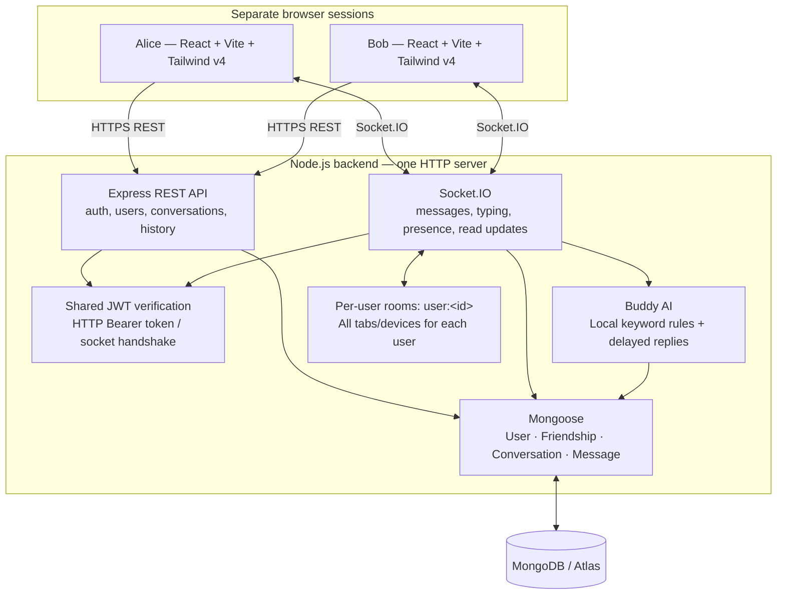
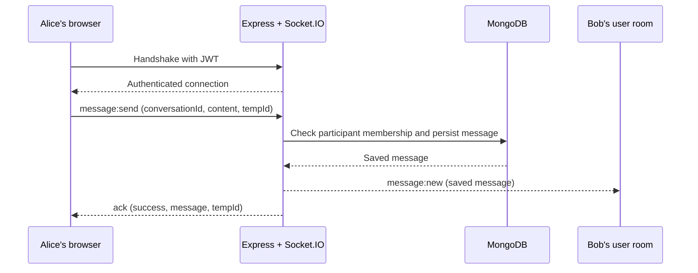

# chit-chat architecture

This diagram reflects the implemented MERN chat architecture. A separate project
brief diagram is not checked into this repository, so an exact visual match to
that original cannot be verified here.

When hosted as prepared in [DEPLOYMENT.md](DEPLOYMENT.md), Vercel serves the
frontend, Render runs the backend, and Atlas stores the data. The same boundaries
apply on localhost. This describes the deployment design, not a verified live
deployment.

## How a message travels

1. **Client emit.** Alice's browser creates a temporary message with a clock and
   emits `message:send` with `{ conversationId, content, tempId }`. It does not
   choose the sender ID. The temporary row is not labelled Sent yet.
2. **Server authentication.** Socket.IO has already verified the JWT during the
   connection handshake and attached the authenticated user's identity. A new
   handshake on reconnect verifies the token again. HTTP uses that same JWT in
   its Bearer header. Passwords are bcrypt-hashed on account creation.
3. **Validate and authorize.** The handler cleans the content, rejects empty or
   overlong messages, and looks up the conversation with the authenticated user
   in its participants. It also verifies a current accepted friendship, unless
   the other participant is Buddy. An outsider cannot send into it; an unfriended
   former participant cannot send new messages even though old history remains readable.
4. **Persist.** Mongoose saves the message in MongoDB and updates the
   conversation's last-message reference. A persisted `tempId`, unique for the
   sender/conversation, lets retries reuse the saved message.
5. **Acknowledge the sender.** The callback returns `{ success: true, message,
   tempId }`. Alice reconciles the temporary row with the saved message and can
   show a single Sent check. Errors/timeouts keep the send retryable.
6. **Deliver to the recipient's room.** `message:new` carries the saved message
   to `user:<bobId>`, reaching Bob's connected sessions without a page refresh.
   The handler targets both participants' rooms and excludes the sending socket,
   so Alice's other tabs also receive it. The current implementation queues this
   broadcast immediately before calling the acknowledgement; the two delivery
   paths can arrive in either order. Persistence precedes both.

## History, read state, and transient events

- REST provides registration/login, authenticated user search, conversation
  listing, and membership-checked history. Refresh/reconnect loads saved history
  and reconciles it with existing message IDs rather than duplicating rows.
- Opening a visible, successfully loaded conversation emits `message:read`.
  The server validates membership, advances that participant's `lastReadAt`, and
  emits `message:read:update` to both user rooms. REST computes `unreadCount`
  from other-user messages after that position. A sender's double check means
  the other participant's read position reached the message timestamp.
- Typing and online status are transient Socket.IO events. Presence counts all
  sockets for a user; closing one tab does not mark a user offline while another
  remains connected. These presence records live in one backend process's
  memory, not MongoDB. Group chat and multi-instance coordination are outside
  this project's scope.

## Friend requests and Buddy

`Friendship` has a unique sorted pairKey and pending/accepted status. The recipient
alone may accept/decline, and the requester alone may cancel. A reciprocal pending
request auto-accepts; concurrent inserts are resolved through the unique index.
Decline, cancel and unfriend delete the friendship document. Conversations and
messages are preserved, and become visible in the list again when users re-friend.

Search requires two characters, excludes the caller and bots, and masks emails
unless the users are accepted friends. Discovery is search-only; the sidebar has
Chats and Requests tabs. Request attempts have a per-process in-memory limit of
20 per user per hour. Four room-scoped events keep request badges and friendships
current: friend:request, friend:accepted, friend:removed, friend:request:removed.

Presence snapshots include online friends and Buddy, and human status changes
are published only to friends' rooms. Empty room lists are never broadcast.
Accepting a friendship publishes online status between the new friends; unfriending
removes those dots and stops subsequent scoped presence/typing updates.

Buddy is a reserved isBot user initialized after MongoDB connects. Each user gets
one Buddy conversation and one welcome message on registration or their next
conversation listing. A newly persisted user message is acknowledged before a
700–1500ms timer creates Buddy's reply. Typing/reply/read events go to all of that
user's tabs. Retrying the same tempId does not schedule another reply. Failures
are contained and always stop the bot's typing indicator when pending replies finish.
Buddy uses local keyword rules, not an external AI API; it cannot be requested,
unfriended, hidden, or logged into as a human.
